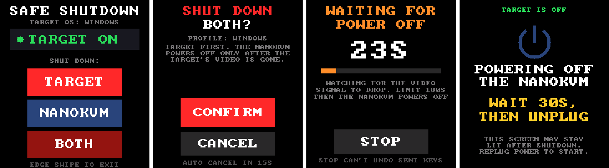

# Safe Shutdown for NanoKVM Go

A touchscreen App for the [Sipeed NanoKVM Go](https://wiki.sipeed.com/hardware/en/kvm/NanoKVM_Go/introduction.html) that gracefully shuts down the computer it's plugged into (the **target**), the **NanoKVM Go itself**, or **both**. For the target, it waits until the video signal disappears to confirm it actually turned off. For the NanoKVM, it powers off cleanly so you can unplug it without corrupting its storage.



## How it works

The home screen has three buttons:

| Button | What happens |
| --- | --- |
| **TARGET** | Shuts down the connected computer and confirms it went dark. |
| **NANOKVM** | Powers off the NanoKVM Go cleanly. Wait 30 seconds, then unplug it. |
| **BOTH** | Shuts down the target first. The NanoKVM powers off only after the target's video is gone; if the target doesn't turn off, the NanoKVM stays on. |

Every action asks for **CONFIRM** first, and the confirm screen cancels itself after 15 seconds. After a TARGET-only shutdown succeeds, the result screen also offers **POWER OFF NANOKVM TOO**.

### Shutting down the target

1. Tap **TARGET** (or **BOTH**), then **CONFIRM**.
2. The App types an OS-specific shutdown sequence into the target through the NanoKVM Go's emulated USB keyboard. It sends the keys through the device's local MCP endpoint (`press_keys` / `type_text`).
3. It then takes a low-quality screenshot every 2 seconds. Once 3 in a row fail, it reports **TARGET IS OFF**. If video is still there after the timeout, it shows **STILL ON?** with a **RETRY** button.

The home screen also shows whether the target currently has a video signal.

### Powering off the NanoKVM Go

Pulling power from a running NanoKVM can corrupt its eMMC and its shared exFAT data disk. The **NANOKVM** button powers it off cleanly instead:

- **Refuses while files are moving.** The device's file transfers and virtual-disk changes hold a storage lock (`/run/nanokvm-storage.lock`). If that lock is busy, the App says so and won't power off. Once it starts, it holds the lock so no new transfer can begin.
- **Warns about the shared data disk.** If the NanoKVM's data disk is attached to the target as a USB drive, the target may still have writes in its cache, so the App tells you to eject it on the target first. This is a common cause of a corrupted data disk. With **BOTH**, the target is already off by then, so there's nothing to eject.
- **Shuts down through systemd.** It runs `sync`, then `systemctl poweroff`, so services stop and filesystems unmount properly.

The NanoKVM can't cut its own power, so wait about **30 seconds** after the "Powering off" screen appears, then unplug it. The panel may stay lit showing that last screen even though the system has halted. Plug it back in to start it up. Turning the NanoKVM off doesn't need MCP or a valid target profile, so the button works even when those aren't set up.

> **"Video lost" isn't the same as "powered off."** A target that falls asleep or turns off its display also loses video. The App always sends a real shutdown request, so treat the green screen as "the shutdown went through and the screen went dark."

## Requirements

- NanoKVM Go firmware that includes the Apps feature (Settings → Apps).
- **MCP turned on** in the NanoKVM web UI. The App uses the local MCP endpoint to send keys and take screenshots. You don't have to copy the key: the App reads it from `/etc/kvm/ai.json` on the device.
- For most profiles, a target that's **logged in and unlocked** (see below).

## Install

**From a ZIP (easiest):** download `safe-shutdown-<version>.zip` from [Releases](../../releases), then go to **Settings → Apps → Installed → Upload ZIP**.

**Over SSH:**

```bash
scp -r safe-shutdown root@<nanokvm-ip>:/kvmcomm/apps/
ssh root@<nanokvm-ip> python3 -m py_compile /kvmcomm/apps/safe-shutdown/main.py
```

The App shows up on the device within about 10 seconds.

## Settings

You set these in the install form or under Settings → Apps → Installed.

| Setting | Default | Meaning |
| --- | --- | --- |
| `TARGET_OS` | `windows` | Which shutdown sequence to send (see profiles below). |
| `CUSTOM_SEQUENCE` | — | Your own sequence, used when `TARGET_OS` is `custom`. |
| `VERIFY_TIMEOUT` | `180` | Seconds to wait for the video signal to drop (20–900). |
| `NANOKVM_MCP_KEY` | — | Optional. Leave empty to use the key from `/etc/kvm/ai.json`. |

### Profiles

| `TARGET_OS` | What it sends | Notes |
| --- | --- | --- |
| `windows` | Win+R → `shutdown /s /t 0` → Enter | Needs an unlocked session. No `/f` flag, so apps with unsaved work can still ask you to save. |
| `windows-dialog` | Win+D → Alt+F4 → Enter | Uses the "Shut Down Windows" dialog. Needs an unlocked session. |
| `linux-power-key` | HID **Power** key | Works when locked or headless. systemd-logind powers off by default (`HandlePowerKey`). Some desktops show a prompt that times out into shutdown. |
| `linux-terminal` | Ctrl+Alt+T → `systemctl poweroff` → Enter | Needs an unlocked desktop that opens a terminal on Ctrl+Alt+T. |
| `macos` | Ctrl+F2 → Apple menu → "Shut Down…" → Enter | **Experimental.** Needs an unlocked session and default keyboard shortcuts. |
| `custom` | `CUSTOM_SEQUENCE` | See below. |

Every built-in profile except `linux-power-key` starts with a Shift press to wake the display.

> ⚠️ **Locked screens.** The `windows` profile types its command wherever focus is. If the target is locked, that text can land in the password box and count as a failed sign-in attempt. Use it only on targets you know are unlocked. For servers, prefer `linux-power-key`.

### Custom sequences

Steps are separated by `;`:

| Step | Example | Effect |
| --- | --- | --- |
| `key:` | `key:ControlLeft+AltLeft+Delete` | Press a chord. Key names are [`KeyboardEvent.code`](https://developer.mozilla.org/docs/Web/API/UI_Events/Keyboard_event_code_values_values) values. |
| `key:…@ms` | `key:Power@800` | Hold the chord (1–1000 ms). |
| `text:` | `text:sudo poweroff` | Type ASCII text exactly as written, US layout. |
| `wait:` | `wait:1500` | Pause (0–30000 ms). |

Write `\;` for a literal semicolon inside `text:`.

Example: on a Linux console where the target is logged in as root on tty1:

```text
key:ControlLeft+AltLeft+F1; wait:1500; text:systemctl poweroff; key:Enter
```

## Troubleshooting

| Screen shows | Fix |
| --- | --- |
| `MCP IS DISABLED` | Turn on MCP in the NanoKVM web UI. |
| `NO MCP KEY` | Turn on MCP once so the device generates a key. |
| `BAD MCP KEY` | Clear the App's `NANOKVM_MCP_KEY` setting so it reads the current key. |
| `SETTINGS ERROR` | The profile or custom sequence is invalid. The screen says which step. NanoKVM power-off still works from this screen. |
| "A file transfer… is in progress" | Let the upload, download, or virtual-disk change finish, then try again. |
| `KVM STILL ON` | `systemctl poweroff` failed. The error is shown on screen and in the log. |
| `STILL ON?` | Check the target's screen. It's probably locked, an app is asking to save, or the profile doesn't fit that OS. |

The log is at `/tmp/safe-shutdown.log` on the device.

## Development

```text
safe-shutdown/          the App (what gets installed)
  app.json              manifest and settings form
  main.py               touchscreen UI (appbase)
  shutdown_core.py      MCP client, sequences, power-off watcher (no device needed)
  kvm_power.py          clean power-off of the NanoKVM itself
tests/                  unit tests against a fake MCP server
tools/render_screens.py renders every screen to PNG and checks the BOTH flow, without a device
tools/build_zip.sh      builds dist/safe-shutdown-<version>.zip
```

```bash
python3 -m unittest discover -s tests -v
curl -fsSL -o /tmp/appbase.py https://raw.githubusercontent.com/sipeed/NanoKVM-Go-Apps/base/appbase.py
python3 tools/render_screens.py --appbase /tmp/appbase.py   # needs Pillow
tools/build_zip.sh
```

CI runs the tests and renders the screens against the current upstream SDK. When you push a `v*` tag, it builds the ZIP and attaches it to the GitHub release.

`appbase.py` is Sipeed's App SDK. It ships on the device and isn't included in this repo.

## License

MIT. See [LICENSE](LICENSE). Not affiliated with Sipeed.
